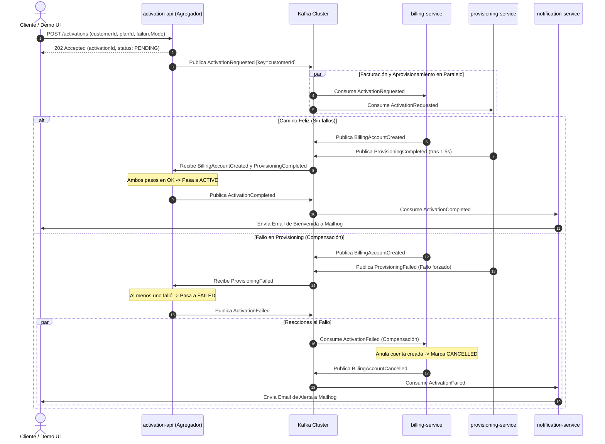
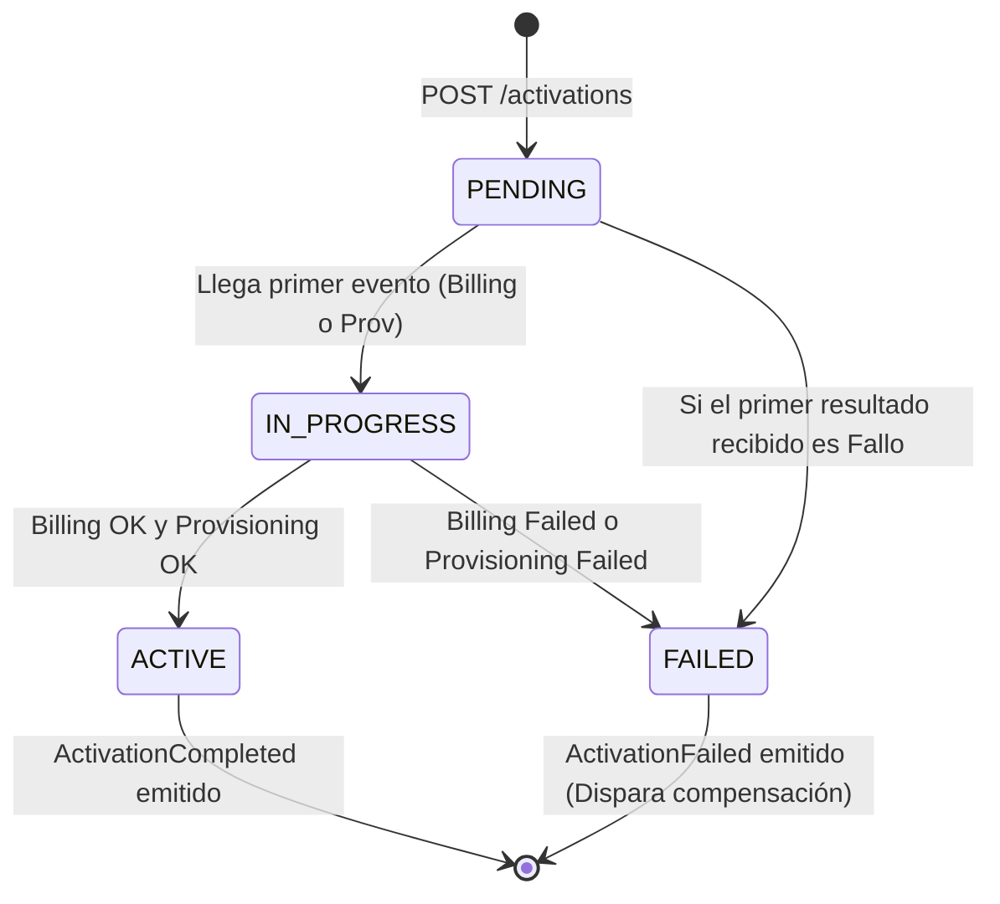

<!--
=================================================================================================
ARCHIVO: docs/architecture.md
=================================================================================================
DESCRIPCIÓN DE LO REALIZADO EN ESTE DOCUMENTO:
1. Documento exhaustivo de arquitectura de software para la POC de Activación de Servicios con Kafka.
2. Contiene la especificación formal del patrón Saga Coreografiada con Agregador.
3. Detalla el diseño de datos, tópicos, sobres de eventos, garantías de entrega y partición por customerId.
4. Explica detalladamente las decisiones técnicas de Idempotencia, Reintentos con Backoff Exponencial,
   Dead Letter Queues (DLQ) y Transactional Outbox.
5. Presenta diagramas de secuencia y flujo en formato Mermaid para visualización arquitectónica.
=================================================================================================
-->

# POC Activación de Servicios con Apache Kafka

**Carrera:** Ingeniería en Sistemas de Información  
**Cátedra:** Sistemas Distribuidos - Ciclo 2026  
**Documento de Arquitectura y Diseño Técnico**

---

## 1. Resumen Ejecutivo y Alcance

La presente Prueba de Concepto (POC) demuestra que la activación de planes de telecomunicaciones puede desacoplarse completamente mediante el paradigma de **Arquitectura Orientada a Eventos (EDA)** sobre **Apache Kafka en modo KRaft**, eliminando las llamadas sincrónicas punto a punto (REST/gRPC) directas entre microservicios.

Cuando un usuario contrata un plan desde la interfaz web (React), la API de entrada emite un único evento de dominio (`ActivationRequested`). A partir de ese evento, los subsistemas de Facturación (`billing`), Aprovisionamiento de red (`provisioning`), Notificaciones (`notification`) y Auditoría (`crm-analytics`) reaccionan de manera asíncrona, autónoma y concurrente.

### Componentes Incluidos
- **Demo UI (React + Vite + Socket.IO):** Tablero de control interactivo con formulario de contratación, inyector de fallos forzados y línea de tiempo (timeline) de eventos en tiempo real.
- **Cinco Microservicios NestJS:**
  1. `activation-api`: Punto de entrada REST, WebSocket Gateway y Agregador de estado de la Saga.
  2. `billing-service`: Facturación simulada, generador de cuentas y compensación reactiva.
  3. `provisioning-service`: Simulación de equipamiento de red y aprovisionamiento con retardo físico (1 a 3 segundos).
  4. `notification-service`: Emisión de correos transaccionales a Mailhog.
  5. `crm-analytics-service`: Consumidor universal de eventos para auditoría histórica.
  6. `loyalty-service` *(Escenario 5)*: Servicio de fidelización que demuestra el *replay* histórico del log con `auto.offset.reset = earliest`.
- **Infraestructura Local:** Kafka KRaft (1 broker), Kafka UI (Kafbat), MongoDB (Replica Set `rs0` para transacciones) y Mailhog.

---

## 2. Topología de Tópicos y Contratos de Eventos

Todos los tópicos fueron configurados con **3 particiones** y una retención de **7 días** (`retention.ms = 604800000`), utilizando el `customerId` como clave de partición (`message key`):

| Tópico | Eventos que Circulan | Productor | Consumidores (Consumer Group) |
|---|---|---|---|
| `activation.requested` | `ActivationRequested` | `activation-api` | `billing-svc`, `provisioning-svc`, `crm-analytics` |
| `billing.events` | `BillingAccountCreated`, `BillingFailed`, `BillingAccountCancelled` | `billing-service` | `activation-api`, `crm-analytics` |
| `provisioning.events` | `ProvisioningCompleted`, `ProvisioningFailed` | `provisioning-service` | `activation-api`, `crm-analytics` |
| `activation.events` | `ActivationCompleted`, `ActivationFailed` | `activation-api` | `notification-svc`, `billing-svc`, `crm-analytics`, `loyalty-group` |
| `<topic>.dlq` | Mensajes con fallos técnicos persistentes | Cualquier consumidor | Inspección manual en Kafka UI |

### Clave de Partición (`customerId`)
Al fijar `key = customerId`, Kafka garantiza mediante su algoritmo de particionamiento (`murmur2(key) % partitions`) que todos los eventos asociados al mismo cliente caerán ineludiblemente en la misma partición física. Esto asegura **orden total garantizado por cliente** (RNF-02), impidiendo que se procese una cancelación antes que una creación para un mismo abonado.

### Sobre Estándar (Event Envelope)
Todos los eventos viajan envueltos en un sobre canónico:

```json
{
  "eventId": "7c9e6679-7425-40de-944b-e07fc1f90ae7",
  "eventType": "ActivationRequested",
  "version": 1,
  "occurredAt": "2026-10-29T17:00:00.000Z",
  "correlationId": "act-1042",
  "customerId": "C-1001",
  "source": "activation-api",
  "payload": {
    "planId": "Fibra Óptica 500 MB Simétrica",
    "channel": "web",
    "simulateFailure": "none"
  }
}
```

---

## 3. Patrón Saga Coreografiada con Agregador

El sistema implementa una **Coreografía con Agregador**:



### Máquina de Estados de la Activación



---

## 4. Cuatro Pilares Técnicos de Resiliencia

### 1. Idempotencia en Cada Consumidor (RNF-03)
Kafka provee entrega de mensajes con semántica *"al menos una vez"* (at-least-once). Si un contenedor se detiene antes de comitear su offset, el mensaje será reenviado.
Para garantizar **idempotencia**:
- Cada microservicio mantiene una colección `processed_events` en su base de datos aislada de MongoDB.
- Se intenta insertar atómicamente el documento `{ eventId, consumerGroup }`.
- La existencia de un índice único sobre dicho par produce un error `E11000` ante un reenvío; en ese caso el consumidor descarta el mensaje duplicado sin volver a ejecutar la lógica de negocio (no genera cobros duplicados ni emails repetidos) y confirma el offset inmediatamente.
- Un índice **TTL de 7 días** sobre el campo `expireAt` purga los registros viejos en sincronía con la retención de Kafka.

### 2. Reintentos Exponenciales y Dead Letter Queue (DLQ) (RNF-04)
Ante fallos técnicos no controlados (ej: saturación de red, corte transitorio de base de datos):
- El servicio ejecuta hasta **3 reintentos** con esperas progresivas: **1 s, 2 s y 4 s**.
- Si la anomalía persiste, el mensaje es enviado al tópico `<topic>.dlq` con los headers técnicos:
  - `x-error-message`
  - `x-error-stack`
  - `x-original-topic`
  - `x-retry-count`
  - `x-failed-at`
- Luego de desviar a la DLQ, el consumidor confirma el offset del tópico principal, **evitando el bloqueo del procesamiento del resto de la partición**.

*(Nota de Dominio: Los errores de negocio forzados vía `simulateFailure` no van a DLQ; se traducen inmediatamente en `BillingFailed` o `ProvisioningFailed`).*

### 3. Transactional Outbox (Decisión 3 / Fase 4)
Para evitar la anomalía de *Dual-Write* (guardar en base de datos pero caerse antes de emitir a Kafka):
- Los eventos se registran en una colección `outbox` (`status = PENDING`) en la misma transacción MongoDB que el estado de negocio.
- Un proceso de fondo (*Outbox Worker*) consulta cada **500 ms** los registros pendientes, los publica en Kafka asegurando la clave de cliente y los marca como `PUBLISHED`.

### 4. Mitigación del Caso Borde de Carrera en Compensación
Si `provisioning` falla en cuestión de milisegundos mientras `billing` demora en procesar su cuenta:
- `billing-service` podría recibir el evento compensatorio `ActivationFailed` antes de haber creado la cuenta en su base de datos.
- Para mitigar esto, `BillingService` registra cancelaciones anticipadas en su memoria y base de datos local. Cuando la creación rezagada intenta concretarse, detecta que la activación ya fue cancelada y crea la cuenta directamente en estado `CANCELLED`, asegurando que no quede ninguna cuenta activa huérfana.
